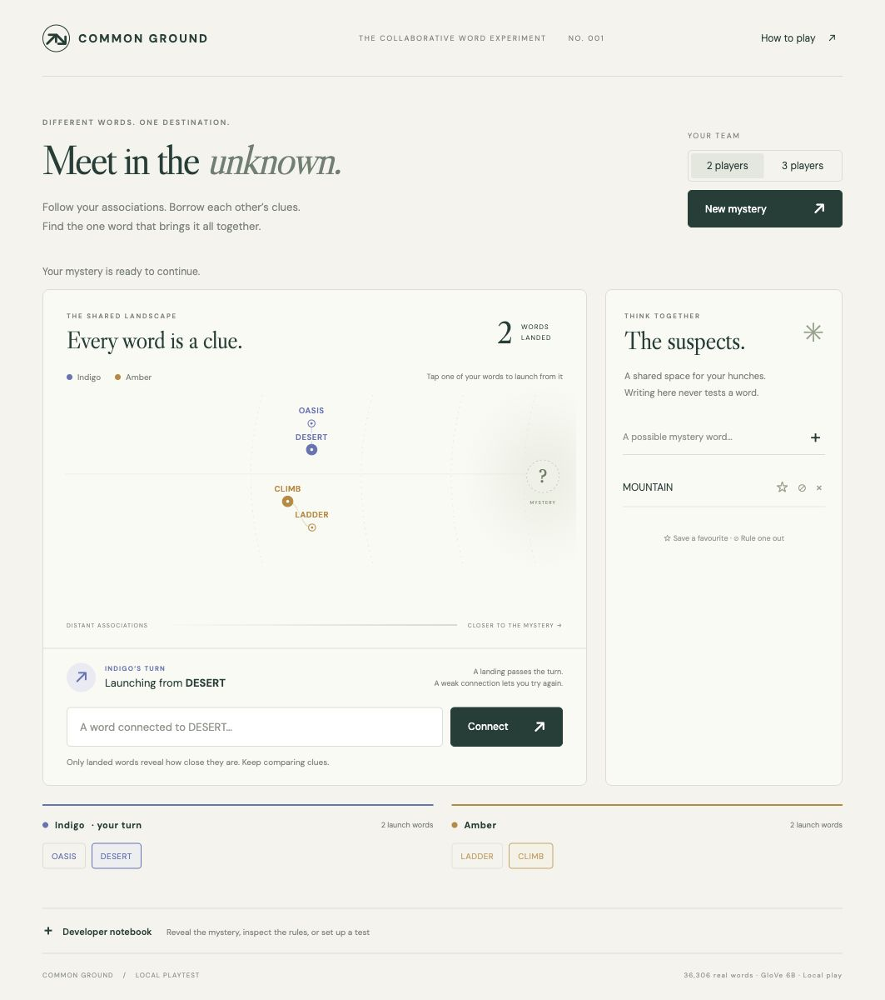

# Common Ground

A playable local prototype of a collaborative mystery-word game for **two or three players**, all controlled from the same browser. Built from the Word Golf embeddings and vocabulary in [dixelstuff/escape-velocity](https://github.com/dixelstuff/escape-velocity).



## Run

Python 3.11+ recommended. From this repository:

```sh
python3 -m venv .venv
.venv/bin/python -m pip install -r requirements.txt
.venv/bin/python server.py
```

Open **http://localhost:8001**. Use `--port 8002` if needed. The bundled 36,306-word, 300-dimensional GloVe model is ready to play: no model download, API key, build step, account, remote scoring or multiplayer service. The Python process binds only to loopback and serves the UI and local game actions. Google Fonts are optional; system fonts work offline.

Choose a team size, start a mystery, then alternate turns. Select any of the active player's words as a launch point. A valid connection lands, reveals proximity, and passes the turn. Retreats are legal and earlier words remain available. A weak connection gives no target-distance information and leaves the turn unchanged. The shared suspects board never checks or scores hypotheses; favourite, eliminate and remove freely.

The team result counts successful words only, excluding starting words and failed attempts. A new mystery clears the board. Refreshing the same tab resumes its round while the Python process is running. Sessions are held in memory, capped at 100; restarting the process clears them. This is local pass-and-play, without remote networking or accounts.

## Developer notebook

Expand **Developer notebook** below the collections. Opening it alone reveals nothing. **Reveal target & diagnostics** shows:

- Target, exact discovered-word similarities, launch thresholds and hub values.
- Starting-word proximity, legal connection count, forward options and pairwise separation.
- Verified sample finish routes for automatically selected starts.
- Density-calibrated finish cutoff and any nonliteral finishing neighbours.
- Successful move metrics and the provisional accolade formula.

Explicit revelation marks the result as a developer test. Override the target, supply comma-separated starting words matching the team size, or enter an integer random seed. Custom starts bypass fairness checks, but not vocabulary, uniqueness or finish-zone validation. **Download diagnostics** exports the current exposed test, including the target. Failed proposals are never retained, even in the notebook. Revealing again refreshes the diagnostics; subsequent successful moves refresh them automatically while exposed.

## Rules and calibration

`vendor/word_golf.py` reuses Word Golf's actual `Embeddings` class, cosine calculations, vocabulary and integrity-checked hub data. Only resource paths changed. `data/vectors.npy` and `data/words.json` are the original normalized float32 model, copied without conversion. GloVe similarities are never synthetic or hand-authored.

**Connection strength.** For launch word L and hidden target T:

```text
s = cosine(L, T)
r = clamp((1 − s) / 0.9, 0, 1)
required(L) = 0.095 + 0.120 × r + 0.035 × hub(L) × r²
land if cosine(L, proposed) + 1e-7 >= required(L)
```

This adapts Word Golf's existing 0.095–0.215 range and 0.035 maximum hub adjustment. The required strength is constant for every proposal from the same launch word. The destination's hub is deliberately excluded: it would make the threshold depend on the proposal. There is no water, progress boundary, forward-only rule or penalty for failed attempts. A previously owned word is selected as a launch point rather than submitted again. Words owned by another player may be discovered independently.

**Distance display.** Word Golf's curved `progress**0.55` mapping is reused on a fixed shared cosine domain, adapted to a shared mystery landscape. Every player uses the same axis and it stays fixed when branching. Higher similarity moves right. Vertical rows separate players and avoid label collisions; they have no semantic meaning. The map keeps negative similarities visible. Exact values are restricted to developer diagnostics.

**Starting positions.** Generate candidates from 3,429 common concrete noun lemmas in the existing vocabulary, using WordNet categories animal, artifact, body, food, location, natural object, plant and substance. They must lie in a cosine shell of 0.10–0.19 around the target. Shuffle deterministically if a seed is supplied and examine up to 120 candidates. Evaluate their actual launch requirements against the full vocabulary, then sample 1,800 teams. Require:

- Target-similarity spread ≤ 0.025; each pair's mutual cosine ≤ 0.24.
- Legal connection counts within a factor of 1.8, with at least 30 per start.
- Forward options (≥ 0.05 cosine gain) within a factor of 2, with at least 12 per start.
- No legal opening into the finishing zone.
- A verified path into the finish through a bounded graph of the 800 closest target words and the candidate starts.

Rank eligible teams by proximity equality, semantic separation, degree equality, forward-option equality and hub similarity. The bounded graph certifies a playable route, **not** a global shortest path or independent human deduction routes. Semantic separation is a heuristic for varied clues, not proof of disjoint routes; common hubs can still unite them. A 30-word curated target pool provides a sensible first playtest set. Custom supported targets can be tested through the notebook. Automatic rounds retry selection if necessary; explicit overrides report errors rather than silently replacing the requested setup. `scripts/build_start_vocabulary.py` reproduces the noun list from Word Golf's WordNet archive.

**Finishing.** The exact target always qualifies after a legal connection. Otherwise use a cutoff `max(0.88, min(0.97, second_strongest_nonliteral_neighbour + 0.005))`. This is much tighter than Golf's 0.27 green. It normally admits at most one exceptionally close neighbour; ties above the 0.97 cap can admit more. Sparse targets require exact identification. The density adjustment prevents broad musical clusters from finishing VIOLIN via PIANO or CELLO. High cosine cannot guarantee synonymy; inspect listed finish neighbours during calibration. There is no added automatic stroke.

**Accolades.** Word Golf's current multi-leg harmonic cleverness architecture relies on a known target, actual route roles, alternative dogleg landings, backward/forward leg evidence and mechanical replay. Those assumptions do not fit freely branching hidden-target exploration. This prototype does not label a shortcut formula as the original score.

- **Most Clever:** strongest landed `max(0, target cosine gain) × (1 − connection cosine) × (1 − 0.5 × maximum endpoint hub)`. An experimental reward for useful, less obvious connections with hub suppression. Useful backward setups are not yet recognised.
- **One Hit Wonder:** largest positive target cosine advance in one landing.
- **Finisher:** the player who legally enters the finish zone.

These are secondary acknowledgements; no individual ranking or arbitrary /100 rating. Ties go to the earliest move. If no move has a positive gain, the positive-gain awards are omitted.

## Verify

```sh
.venv/bin/python -m unittest discover -s tests -v
node --check static/app.js
```

Nine tests include 60 real-vector completed rounds (all 30 targets with two and three players), balance bounds, witnessed routes, failure privacy, fixed launch thresholds, backward landings, branch ownership, suspects isolation, tight finishes, reproducibility and HTTP requests. The UI has also been exercised in the browser. Fairness measures and mathematical reachability are not a substitute for evaluating fun with human playtests.

## Data attribution

Word vectors: Stanford **GloVe 6B 300d**, Wikipedia 2014 + Gigaword 5; [PDDL 1.0](https://opendatacommons.org/licenses/pddl/1-0/). Vocabulary selection originates in Word Golf, using **wordfreq 3.1.1** English frequency ranks ([frequency data CC BY-SA 4.0](https://github.com/rspeer/wordfreq)) intersected with Princeton WordNet lemmas, with the same later dictionary extensions. The inherited selected vocabulary and derived noun list are distributed with that attribution and share-alike notice. See [data/ATTRIBUTION.txt](data/ATTRIBUTION.txt) and [data/WORDNET-LICENSE.txt](data/WORDNET-LICENSE.txt). No new embeddings or scoring service is used.
